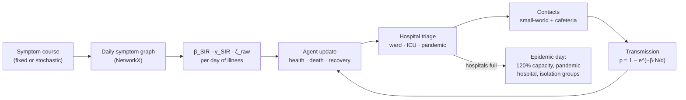
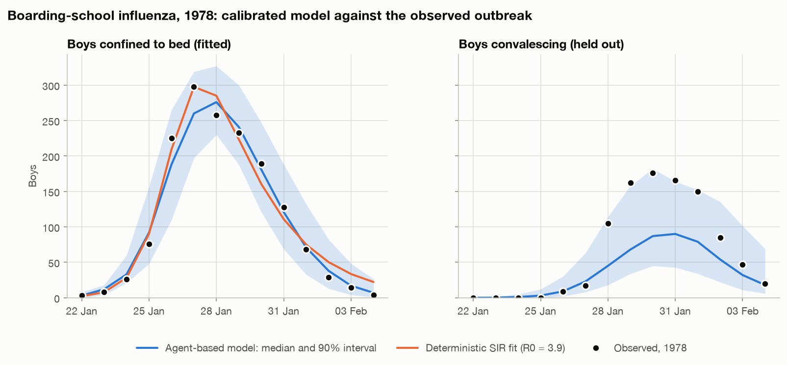
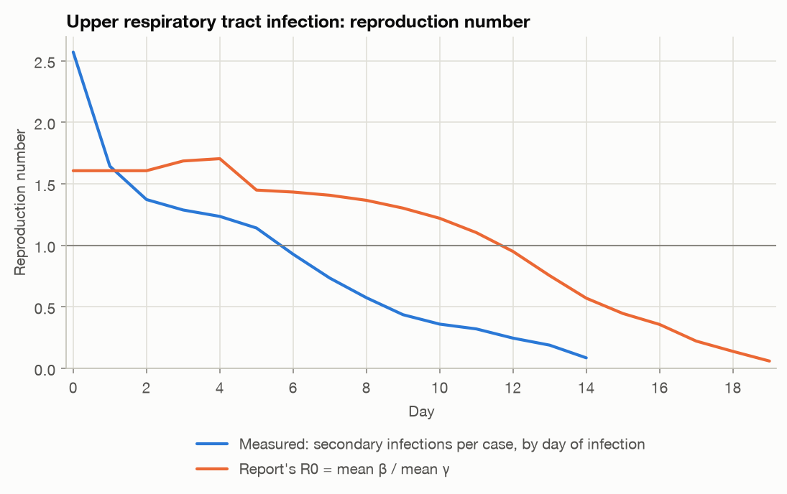
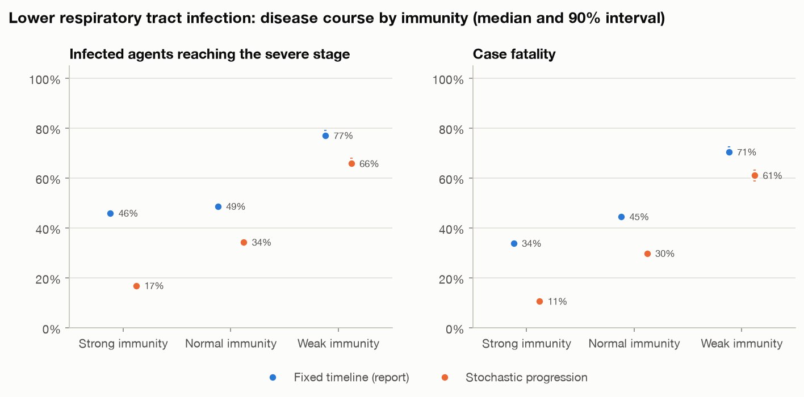
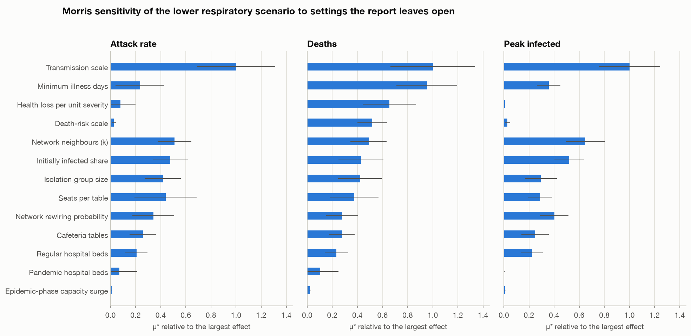
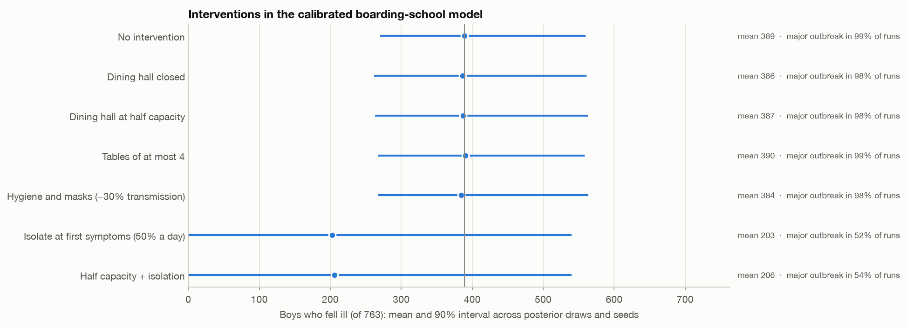
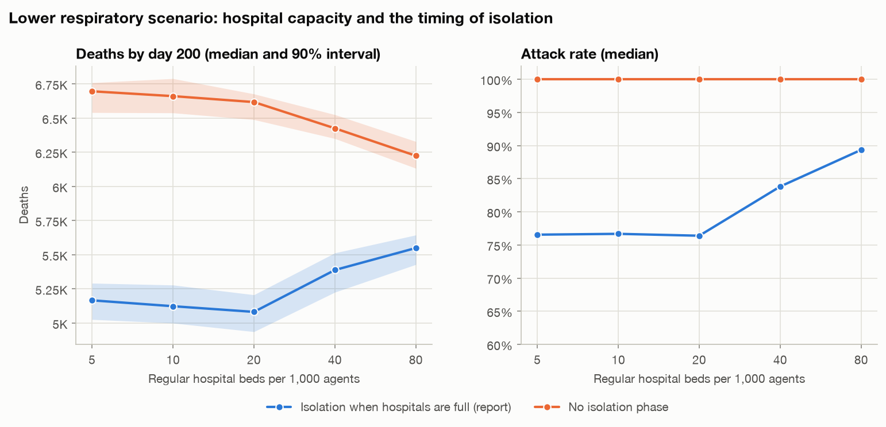

# Symptom-Based Agent-Based Epidemic Model

An agent-based epidemic model in which each infected agent's transmission rate, recovery rate and health loss are recomputed every day from a network of interacting symptoms. It is calibrated against a real outbreak, stress-tested with uncertainty and sensitivity analysis, used for planning experiments, and explorable in an interactive app.

## Highlights

- **Validated on real data.** Calibrated with approximate Bayesian computation (ABC) to the 1978 English boarding-school influenza outbreak:
  - the fitted in-bed curve matches about as well as a classic SIR model (RMSE 16.4 vs 16.0);
  - the held-out number of boys who fell ill (512) lies inside the predicted range (271–566).
- **Symptom-network engine.** It reproduces every deterministic value in the report's parameter tables, and fixes a flaw in the original formula: adding a harmless symptom such as fever used to cancel transmission entirely.
- **Uncertainty made explicit:**
  - 50-seed ensembles;
  - a Morris sensitivity screening of 13 settings the report leaves open (280 runs);
  - an optional stochastic, immunity-dependent disease course.
- **Planning results:**
  - isolating at first symptoms is the only school measure that clearly works;
  - starting isolation only when hospitals are full makes extra beds counterproductive.
- **Interactive Streamlit app**, parallel and seeded simulation, 34 tests.

## Overview

Compartmental models such as SIR give everyone the same fixed transmission rate (β) and recovery rate (γ). In reality, infectiousness and severity depend on symptoms. Symptoms change over the course of an illness and reinforce each other: coughing and sneezing together spread a respiratory pathogen more than either alone. Severe symptoms such as pneumonia keep people in bed, which cuts transmission while slowing recovery.

This project implements the model described in the accompanying [report](docs/symptom_based_epidemic_model_report.pdf). Each day, a symptom graph turns an agent's current symptoms into its transmission rate, recovery rate and severity. Those values are then modulated by the agent's immunity class, health reserve and the care it receives. On top of the report's model, the repository adds:
- calibration against observed data;
- infection-chain tracking, which gives a measured reproduction number;
- stochastic disease progression;
- ensembles and sensitivity analysis;
- intervention and capacity experiments;
- an interactive explorer.

## Dataset

- **Model inputs (from the report):**
  - **Symptom coefficients (report Table 1):** transmissibility β⁺ (sneezing 0.84, cough 0.68, runny nose 0.41, diarrhea 0.23), severity ζ (cough 0.20 … coma 0.85), physiological system, and a β⁻ flag for isolation-inducing symptoms (pneumonia, high fever, sepsis, loss of consciousness, coma).
  - **Scenario symptom timelines (report Tables 2–4).**
- **Validation data: the 1978 boarding-school influenza outbreak.**
  - **Contents:** 763 boys, 512 of whom fell ill, with daily counts of boys confined to bed and convalescing from 22 January to 4 February 1978. The index case was infected by 10 January.
  - **Source:** Anonymous (1978), *British Medical Journal* 1:587, distributed in the R package [`outbreaks`](https://github.com/reconverse/outbreaks) (MIT licence).
  - **Access:** the file is downloaded on first use from a pinned commit, checksum-verified and cached in `data/`. It is not redistributed in this repository.

## Approach



| Component | Rule |
|---|---|
| Symptom graph and β | Active symptoms are nodes, and edges join β-defined symptoms of the same physiological system. β is scaled by network position (`max(1, degree/max_degree + 0.4 × system_share)`), combined with a synergy factor `1 + 0.3 (n − 1)/n`, and bounded as `β_SIR = β_c / (1 + β_c)`. Any β⁻ symptom overrides it with a value in [0.001, 0.005]. |
| Severity and γ | Pairwise synergy is weighted by system proximity (0.7) and graph distance (0.3). It gives ζ_raw, which is sigmoid-scaled to ζ_net; `γ = 1 / (1 + e^(4 (ζ_net − ζ_crit)))`, with floors of 0.5 / 0.4 / 0.3 when no β⁻ symptom is present. |
| Agents | Strong, normal or weak immunity, with health reserves of 601–1000, 301–600 or 100–300 and infection-risk multipliers of 0.8 / 1.0 / 1.4. |
| Infection | `p = 1 − exp(−β_i · N_i / d_i)` over network neighbours and cafeteria table-mates, times the immunity multiplier. Every infection records its source and route. |
| Recovery | `P = (1 − e^(−max(γ, 0.01))) × immunity multiplier × health bonus`. Recovery also requires the cumulative γ to exceed a threshold drawn from U(1.5, 3.5) and at least 5 days of illness. |
| Health and death | Daily loss = `2.5 × ζ_raw × immunity modifier − treatment relief` (home 4, ward 12, pandemic 18, ICU 25). Death is certain at 0 health. Under lethal combinations (two or more β⁻ symptoms), the daily risk is `0.02 × (1 − health/1000)`. |
| Hospitals and cafeteria | Agents with β⁻ symptoms seek a bed. Critical cases, or severe cases with low health, go to the ICU. Hunger-driven cafeteria visits form random tables of up to 6. |
| Epidemic phase | When hospitals turn patients away, capacity rises to 120%, a pandemic hospital opens and the network splits into isolation groups of 1–3 agents until the normalization day. |
| Disease course | **Fixed** (report): every agent follows the scenario timeline. **Stochastic**: stage durations vary between agents, and the severe stage is entered with probability 30% / 60% / 90% (strong / normal / weak immunity). An optional latent period is available. |
| Interventions | Self-isolation at first symptoms, a transmission multiplier, cafeteria capacity, and an early-warning or disabled isolation trigger. |

| Analysis | Method |
|---|---|
| Uncertainty | 50 seeds per scenario (parallel), reported as median and 90% interval |
| Sensitivity | Morris elementary effects (SALib), 20 trajectories × 14 points over 13 settings, common random numbers |
| Calibration | ABC rejection on 5 parameters: 5,000 prior draws × 3 seeds, 100 accepted. Runs are aligned on take-off (the first day with ≥20 boys in bed); the predictive is conditioned on a major outbreak. The baseline is a deterministic SIR least-squares fit of β, γ and the start time. |
| Experiments | Interventions are simulated for every accepted posterior draw (400 runs each). A bed-capacity sweep runs under two response policies (20 seeds each). |

Settings the report leaves open are explicit fields of `SimulationConfig`. They include population and infrastructure sizes, the death-risk scale, health loss per unit severity and the minimum illness length. Their influence is quantified by the sensitivity analysis below.

## Results

### Validation: 1978 boarding-school influenza


*Posterior predictive median and 90% interval against the observed counts. The in-bed curve (left) was fitted; the convalescent curve (right) was held out.*

| | Agent-based model | Deterministic SIR |
|---|---:|---:|
| Fitted parameters | 5 | 3 (β, γ, start time) |
| In-bed RMSE (fitted) | 16.4 | 16.0 |
| Observations inside the 90% predictive band | 14 of 14 | – |
| Boys who fell ill (held out; observed 512) | 369 (271–566) | 747 infected, all of them in bed |
| Convalescent curve (held out) | RMSE 48.1; peak 90 vs 176 observed | not modelled |
| Reproduction number | measured early R 3.27 (2.62–4.14) | R0 = 3.93 |

- **Posterior estimates:**
  - days in bed: 4 (3–6);
  - share of infections that led to bed rest: 0.50 (0.36–0.79);
  - latent period: 1 day (0–2);
  - infectious prodrome: 2 days (1–3).
- **Weak identification:** the transmission scale is only bounded from below (8.2, 90% interval 4.1–11.4), because above about 4 spread is limited by contacts and stage durations.
- **Take-off timing:** simulated outbreaks take off 6 (3–8) days after the index infection, against 14 days in 1978. The real first generation was slower than the model's.

### Report scenarios

The engine reproduces the report's parameter tables exactly. Outcomes over 50 seeds (median and 90% interval):

| | Upper respiratory | Lower respiratory | MeV-1-like |
|---|---:|---:|---:|
| Immunity mix (strong / normal / weak), days | 30/60/10, 30 | 40/50/10, 200 | 30/60/10, 150 |
| Attack rate | 100% | 76.7% (75.7–78.3) | 10.4% (9.9–10.8) |
| Peak infected | 10,014 (9,858–10,214) | 8,477 (8,307–8,726) | 1,550 (1,476–1,612) |
| Deaths | 0 | 4,981 (4,857–5,120) | 1,100 (1,039–1,153) |
| Case fatality | 0% | 43.2% (42.7–44.1) | 70.9% (69.4–72.6) |
| Measured early R | 1.90 (1.86–1.92) | 2.07 (2.03–2.13) | 0.72 (0.70–0.75) |
| Report-style R0 peak (mean β / mean γ) | 1.70 (report: 1.73) | 1.72 | 1.54 |


*Upper respiratory infection.*
- **At the start:** counting secondary infections gives 2.97 per initial case, against the report-style R0 of 1.61.
- **Later:** the measured value falls below 1 from day 6, while the ratio of mean rates stays above 1 until day 12.

### Uncertainty and sensitivity


*Lower respiratory infection:*
- *Stochastic progression concentrates severe disease and death in the weak-immunity group.*
- *Deaths fall from 4,981 to 2,584 (2,444–2,657), close to the report's ≈2,500.*


*Morris μ*, relative to the largest effect per output:*
- *Deaths depend most on transmission scale (1.00), minimum illness days (0.95), health loss per unit severity (0.65) and the death-risk scale (0.52), three of which are unquantified in the report.*
- *The capacity surge barely matters (≤ 0.02).*

### Planning experiments


*Interventions in the calibrated school model, across all posterior draws.*
- *Isolating at first symptoms (50% a day) cuts the mean number of boys ill from 389 to 203, by lowering the chance of a major outbreak from 99% to 52%.*
- *Closing the dining hall or cutting per-contact transmission by 30% barely changes the total.*


*Lower respiratory infection.*
- *Without an isolation phase, more beds save lives: 6,618 deaths at 20 beds per 1,000 vs 6,224 at 80.*
- *With the report's rule, isolation starts only when hospitals are full. Extra beds then delay it (day 6 → day 8), and deaths rise from 5,082 to 5,550.*

The four [notebooks](notebooks/) contain every figure and table, with discussion.

## Key findings

- **Severe illness limits spread.** Isolation-inducing symptoms collapse transmission from β_SIR ≈ 0.61–0.69 to 0.001–0.005. A MeV-1-like pathogen that kills 71% of its hosts reaches only about 10% of the population, because its measured R is below 1.
- **Measure R instead of deriving it from mean rates.** Infection-chain tracking shows that the report's β̄/γ̄ ratio understates early transmission by almost half and overstates late transmission.
- **Mortality results rest on unquantified assumptions; spread results are more robust.** The sensitivity screening shows that deaths depend heavily on recovery and mortality settings the report does not quantify. Calibration to the 1978 outbreak pins down attack size, bed days and the share of infections causing bed rest.
- **Act on early signals.**
  - At the school, isolating boys at first symptoms halves the chance of a major outbreak, while dining-hall measures barely help.
  - In the hospital scenario, tying isolation to hospital saturation means added beds delay the response and cost lives.

## Limitations

- **Convalescence:** under the report's recovery rule, convalescence is too short. The held-out convalescent peak is underpredicted by about half.
- **Calibration data:** the model is calibrated on one small outbreak. Mortality-related settings (death-risk scale, health loss) have no data behind them.
- **Take-off:** simulated outbreaks take off faster after the index case than the 1978 outbreak did.
- **Transmission scale:** the calibrated transmission scale is only bounded from below. Conclusions about per-contact measures such as masks inherit that weakness.

## Tech stack

Python 3.10+, NetworkX, NumPy, pandas, SciPy, SALib, Matplotlib, Streamlit, Jupyter and pytest. The report is written in LaTeX.

## Project structure

```
agent-based-epidemic-model/
├── epidemic_abm/
│   ├── symptoms.py       # symptom catalogue and symptom-network parameter engine
│   ├── scenarios.py      # the report's outbreak scenarios
│   ├── model.py          # agents, disease course, hospitals, cafeteria, contacts, SIRD simulation
│   ├── analysis.py       # reproduction numbers, Kaplan–Meier, log-rank test, run summaries
│   ├── ensemble.py       # parallel multi-seed runs
│   ├── sensitivity.py    # Morris screening (SALib)
│   ├── data.py           # download and loading of the 1978 outbreak data
│   ├── calibration.py    # ABC calibration and SIR baseline
│   ├── experiments.py    # interventions and hospital-capacity experiments
│   ├── pipeline.py       # analysis steps behind the figures and results
│   └── plots.py          # figures
├── notebooks/            # 01 report scenarios · 02 uncertainty and sensitivity · 03 calibration · 04 planning
├── tests/                # engine vs report tables, model invariants, survival analysis, calibration, app
├── app.py                # Streamlit explorer
├── run_analyses.py       # reproduces every figure and result
├── results/              # JSON summaries of every analysis
├── figures/
├── docs/
│   └── symptom_based_epidemic_model_report.pdf
├── pyproject.toml
└── requirements.txt
```

## How to run

```bash
git clone https://github.com/efe-akpinar/agent-based-epidemic-model.git
cd agent-based-epidemic-model
python -m venv .venv && source .venv/bin/activate
pip install -e ".[dev]"          # or: pip install -r requirements.txt

streamlit run app.py             # interactive explorer
python run_analyses.py all       # every figure and result (about 20 minutes on 8 cores)
python run_analyses.py scenarios --agents 5000 --seed 7
pytest                           # 34 tests
```

The calibration step downloads the 1978 outbreak data automatically on first use and caches it in `data/`.

To model a different disease, define a `Scenario` with a symptom timeline (day of illness → symptoms) and an immunity mix, and pass it to `run_scenario` with a `SimulationConfig`. The app's "Custom symptom timeline" preset does the same interactively.

Built as a team project (team of 3).
