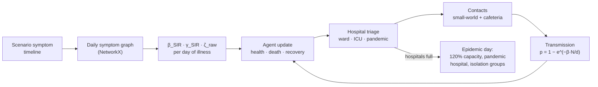
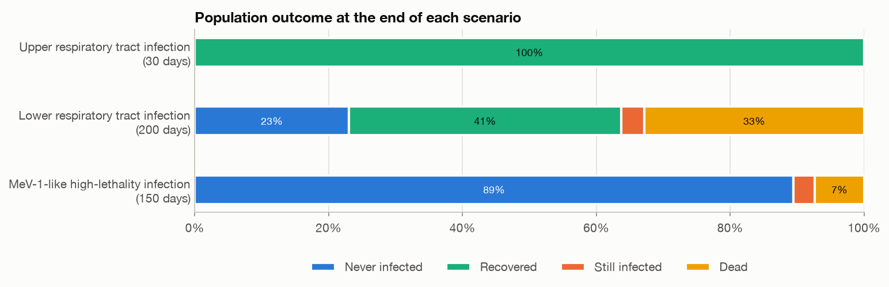
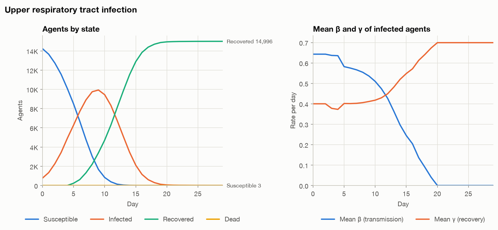
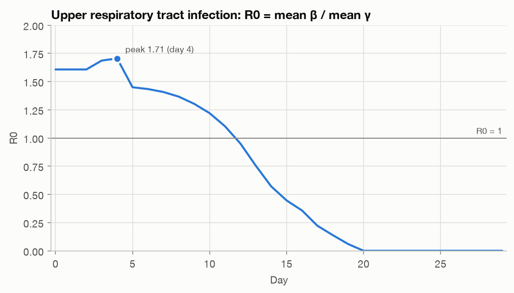
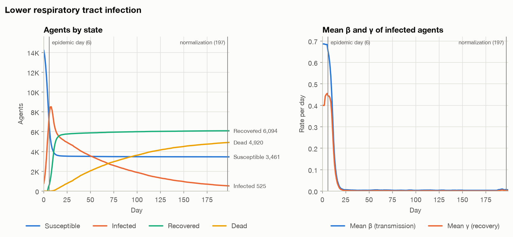
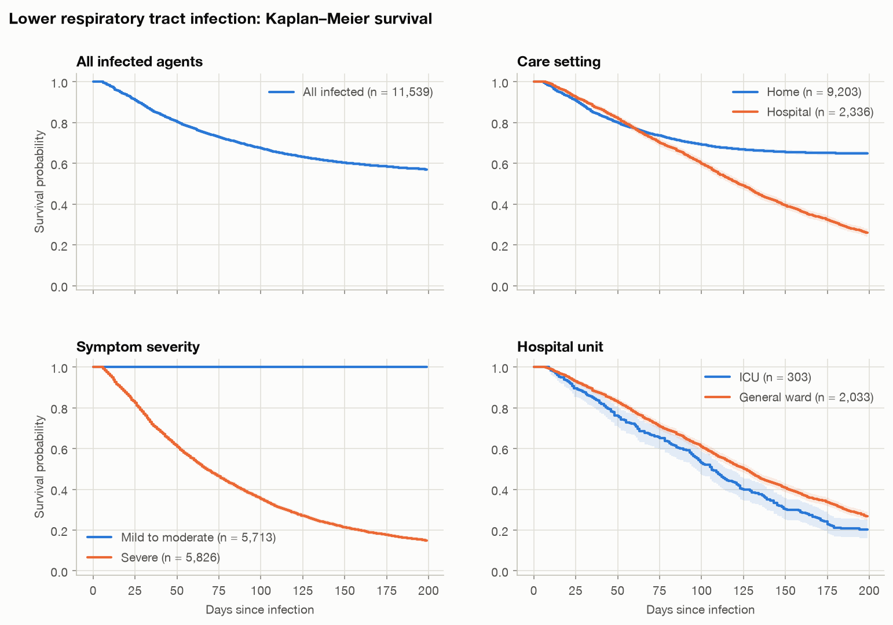
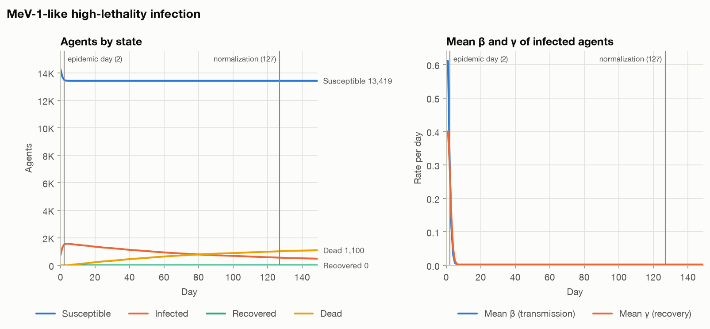

# Symptom-Based Agent-Based Epidemic Model

An agent-based SIRD epidemic model in which each infected agent's transmission rate (β), recovery rate (γ) and health loss are recomputed every day from a network of interacting symptoms. Immunity classes, health reserves, hospital capacity and social contact patterns shape who gets infected, who recovers and who dies.

## Highlights

- Turns daily symptom profiles into SIR parameters with a symptom-network engine. The engine reproduces every deterministic value in the report's parameter tables, and a test enforces this.
- Simulates 15,000 heterogeneous agents. Each has an immunity class, a health reserve, two-step stochastic recovery, health-dependent mortality and triage into general-ward, ICU or pandemic-hospital beds.
- Models contact through a small-world network and hunger-driven cafeteria tables. When hospitals saturate, an epidemic-day isolation phase splits the network into small groups.
- Runs three outbreak scenarios from the report, from a mild upper respiratory infection to a MeV-1-like lethal pathogen, with Kaplan–Meier survival analysis and log-rank tests.
- Pure Python (NetworkX, NumPy, pandas, Matplotlib), seeded and reproducible. All three scenarios run in under 10 seconds.

## Overview

Compartmental models such as SIR assume a homogeneous population with constant β and γ. In practice, infectiousness and severity depend on symptoms, which change over the course of an illness and reinforce each other. Coughing and sneezing together spread a respiratory pathogen more effectively than either alone. Severe symptoms such as pneumonia keep people at home or in hospital, which cuts transmission while slowing recovery.

This repository implements the model described in the accompanying [report](docs/symptom_based_epidemic_model_report.pdf). Each infected agent follows a symptom timeline by day of illness. For each day, a symptom graph yields the agent's transmission rate, recovery rate and severity. These are then modulated by the agent's immunity and health and by the care it receives.

## Dataset

No external dataset is used and no data is redistributed. All model inputs come from the report:

- **Symptom coefficients (report Table 1).** Transmissibility β⁺ (for example sneezing 0.84, cough 0.68, runny nose 0.41, diarrhea 0.23), severity ζ (for example cough 0.20, pneumonia 0.66, coma 0.85), physiological system, and a β⁻ flag for isolation-inducing symptoms (pneumonia, high fever, sepsis, loss of consciousness, coma). The report derives these from physical and clinical characteristics such as droplet dispersal, airborne persistence, surface viral load, recovery time and treatment accessibility.
- **Scenario symptom timelines (report Tables 2–4)** and immunity mixes.

## Approach



| Component | Rule (from the report) |
|---|---|
| Symptom graph | Active symptoms are nodes. Edges join β-defined symptoms of the same physiological system. |
| Transmission β | `β_scaled = β_raw × (degree / max_degree + 0.4 × system_share)`, combined with synergy `× (1 + 0.3 (n − 1)/n)`, bounded as `β_SIR = β_c / (1 + β_c)`. Any β⁻ symptom overrides it with a value in [0.001, 0.005]. |
| Severity and recovery γ | Pairwise synergy weighted by system proximity (0.7) and graph distance (0.3) gives ζ_raw, sigmoid-scaled to ζ_net around an adaptive ζ_crit. `γ = 1 / (1 + e^(4 (ζ_net − ζ_crit)))`, with floors of 0.5 / 0.4 / 0.3 when no β⁻ symptom is present. |
| Agents | Strong, normal or weak immunity with health reserves of 601–1000, 301–600 or 100–300. Infection risk multipliers are 0.8 / 1.0 / 1.4. |
| Infection | `p = 1 − exp(−β_i · N_i / d_i)` over network neighbours ∪ cafeteria table-mates, times the immunity multiplier. |
| Recovery | `P = (1 − e^(−max(γ, 0.01))) × M_immunity (1.5 / 1.0 / 0.6) × health bonus (0.4–4.0)`. The agent recovers only if a uniform draw falls below P **and** its cumulative γ exceeds a threshold drawn from U(1.5, 3.5). |
| Health and death | Daily loss = `2.5 × ζ_raw × modifier (0.7 / 1.0 / 1.3) − treatment relief` (home 4, ward 12, pandemic 18, ICU 25). Death is certain at 0 health. Under lethal combinations (two or more β⁻ symptoms) the daily risk is `0.02 × (1 − health / 1000)`. |
| Hospitals | Agents with β⁻ symptoms seek a bed. Critical symptoms (coma, sepsis, loss of consciousness), or pneumonia and high fever with low health, go to the ICU. Ward patients who turn critical transfer to the ICU when a bed frees up. |
| Cafeteria | Hunger rises 0.5 a day, with a visit probability of hunger / 2.0. Tables are random cliques of up to 6. Critical agents stay away, and β⁻ agents keep at most 3 contacts. |
| Epidemic phase | When hospitals turn patients away while discharges lag demand, capacity rises to 120%, a pandemic hospital opens and the network becomes isolation groups of 1–3. The network returns on the normalization day. |

The report leaves several settings to the user. The defaults used here are in `SimulationConfig`: 15,000 agents, k = 8, rewiring p = 0.1, 3% initially infected, 500 tables, 300 beds (20% ICU) and a 200-bed pandemic hospital. A few rules the report doesn't pin down are also implementation choices:
- Health loss per unit of severity (2.5): this reproduces the report's examples of cough 0.5 and fever 0.75 per day.
- The death-risk scale (0.02).
- The ICU health thresholds.
- A minimum illness duration of 5 days.

## Results

All results below come from this implementation with 15,000 agents and seed 42. The report's own figures came from separate stochastic runs, so individual numbers differ.

### Parameter engine

The engine reproduces the report's tables exactly, including the upper respiratory infection timeline:

| Day of illness | Symptoms | β_combined | β_SIR | ζ_raw | ζ_net | γ_SIR |
|---|---|---:|---:|---:|---:|---:|
| 0–2 | Runny Nose, Sneezing, Muscle Pain | 1.8000 | 0.6429 | 0.988 | 0.8218 | 0.4000 |
| 3–4 | Cough, Runny Nose, Fever, Muscle Pain | 1.6023 | 0.6157 | 1.589 | 1.2493 | 0.3000 |
| 5+ | Muscle Pain | 0.0000 | 0.0000 | 0.350 | 0.1891 | 0.6992 |

### Scenario outcomes

| | Upper respiratory | Lower respiratory | MeV-1-like |
|---|---:|---:|---:|
| Immunity mix (strong / normal / weak) | 30 / 60 / 10 | 40 / 50 / 10 | 30 / 60 / 10 |
| Days simulated | 30 | 200 | 150 |
| Ever infected | 14,997 (99.98%) | 11,539 (76.9%) | 1,581 (10.5%) |
| Peak infected (day) | 9,932 (day 9) | 8,515 (day 8) | 1,572 (day 4) |
| Final S / I / R / D | 3 / 1 / 14,996 / 0 | 3,461 / 525 / 6,094 / 4,920 | 13,419 / 481 / 0 / 1,100 |
| Case fatality | 0.0% | 42.6% | 69.6% |
| Epidemic day / normalization day | none | 6 / 197 | 2 / 127 |
| Kaplan–Meier survival at end of run | 1.00 | 0.57 | 0.30 |


*Final state of the population in each scenario: the mild infection reaches everyone, while the lethal one burns out after reaching 10.5% of agents.*


*Upper respiratory tract infection: infections peak at 9,932 on day 9 and everyone recovers within 30 days, with no deaths.*


*Upper respiratory tract infection: R0 = mean β / mean γ starts at 1.607, peaks at 1.705 on day 4 (report: ≈1.6 and 1.73) and falls below 1 on day 12.*


*Lower respiratory tract infection: hospitals saturate on day 6, isolation halts spread, and deaths accumulate over 200 days among agents who cannot clear their recovery threshold.*


*Lower respiratory tract infection: survival by care setting, symptom severity and hospital unit. Severe cases reach 0.15 against 1.00 for mild-to-moderate ones (log-rank p < 0.0001).*


*MeV-1-like infection: no agent recovers, 69.6% of the infected die, and transmission stops within the first week.*

The [notebook](agent_based_epidemic_model.ipynb) has the full set of figures: daily symptom mix, hospital occupancy, recovery-time distributions and survival curves for every scenario.

## Key findings

- **Severe illness limits spread.** Isolation-inducing symptoms move agents from high-transmission states (β_SIR 0.61–0.69) to 0.001–0.004. In the MeV-1-like scenario, hosts turn critical before they can pass the pathogen on, so a pathogen that kills 69.6% of its hosts reaches only 10.5% of the population.
- **The symptom mix drives R0.** In the upper respiratory infection, R0 peaks at 1.705 on day 4. It then drops below 1 by day 12 as sneezing and runny nose give way to muscle pain and recovery rates rise.
- **A small weak-immunity group shapes the tail.**
  - In the mild scenario, strong- and normal-immunity agents recover in 5–8 days, while weak-immunity agents take up to 23.
  - In the lower respiratory scenario, case fatality is 69.9% for weak immunity versus 44.6% for normal and 32.6% for strong.
- **Hospital saturation changes who survives.** In the lower respiratory scenario the 300 regular beds fill on day 6. Even after the surge, up to 4,652 severe cases a day are treated at home. Hospitalized agents show lower survival than home-treated ones (0.26 vs 0.65), because only the sickest are admitted, and ICU patients fare worst (0.20).

## Tech stack

Python 3.10+, NetworkX, NumPy, pandas, Matplotlib, Jupyter and pytest. The report is written in LaTeX.

## Project structure

```
agent-based-epidemic-model/
├── epidemic_abm/
│   ├── symptoms.py        # symptom catalogue and symptom-network parameter engine
│   ├── scenarios.py       # the report's three outbreak scenarios
│   ├── model.py           # agents, hospitals, cafeteria, contact network, SIRD simulation
│   ├── analysis.py        # Kaplan–Meier, log-rank test, scenario summaries
│   └── plots.py           # figures
├── tests/                 # engine vs report tables, survival analysis, simulation invariants
├── agent_based_epidemic_model.ipynb   # executed walkthrough of all three scenarios
├── run_scenarios.py       # command-line runner: figures/ and results/
├── results/               # per-scenario summaries (JSON)
├── figures/
├── docs/
│   └── symptom_based_epidemic_model_report.pdf
├── pyproject.toml
└── requirements.txt
```

## How to run

No data download is needed.

```bash
git clone https://github.com/efe-akpinar/agent-based-epidemic-model.git
cd agent-based-epidemic-model
python -m venv .venv && source .venv/bin/activate
pip install -r requirements.txt

python run_scenarios.py                                 # all scenarios -> figures/ and results/
python run_scenarios.py --scenario lrti --agents 5000 --seed 7

pip install pytest jupyter
pytest                                                  # 16 tests
jupyter notebook agent_based_epidemic_model.ipynb
```

To model a different disease, define a `Scenario` with a symptom timeline (day of illness → symptoms) and an immunity mix, and pass it to `run_scenario` together with a `SimulationConfig`.

Built as a team project (team of 3).
